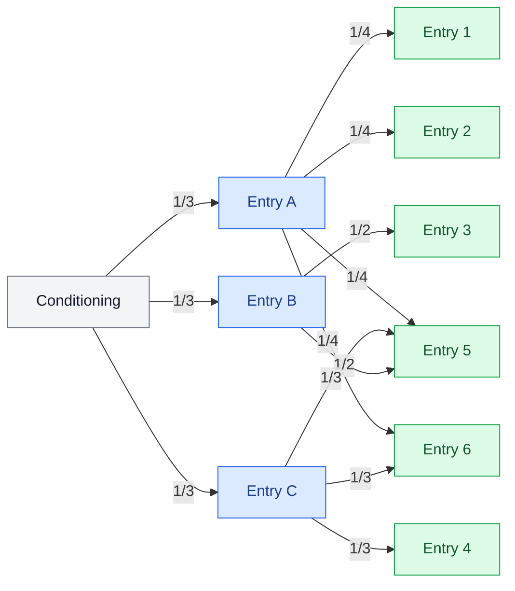

# Character Generator
[](https://pre-commit.com/)

This package can be used to randomly generate characters from a set of tables.

## Basic use

Given a folder of csv tables names `TABLES_DIR/`

```bash
$ char-gen TABLES_DIR
```
will produce a random combination of one entry in each table.

## Options:
This can be obtained with
```
$ char-gen --help
usage char-gen TABLES_DIR [-c CONDITIONING_TABLE]
    -c CONDITIONING_TABLE       The name of the conditioning table found in the TABLES_DIR folder.
    --cn                        Must be used if CONDITIONING_TABLE uses numbers as entries.
    -n NUMBER                   Number of characters to generate.
    --sep OR_CHARACTER          Sets the new character to separated conditionned entries. Default is '+'.
    --tree                      Display the conditioning tree. Can't be used withtout conditioning.
    --mermaid                   Exports the conditioning tree to merdaid. Can't be used withtout conditioning.
```
## Table format

The expected format for the tables are

### Entries only

| Column 1|
|---------|
| Entry 1 |
| Entry 2 |
| Entry 3 |
| ...     |

this assumes the weight of all entries to be the same

### Entries + weights
| Column 1| Column 2 |
|---------|----------|
| Entry 1 | Weigth 1 |
| Entry 2 | Weight 2 |
| Entry 3 | Weight 3 |
| ...     | ...      |

#### Weight format
Weight can be either floats between 0.0 and 1.0 or integer.

If the weights are floats, their sum **must be 1**, otherwise an Error will be raised.

If the weigths are integers, the corresponding probability will be `weight/(sum of all weights)`.

**Behaviour:**
* if a weight with value > 1 is detected, it will assume that all weigths are integers and be cast to `int` if they it makes sense (eg 1.0 -> 1, but not 1.5)

## Advanced use

Some entries of a table may be conditioned by what was picked in another one. This introduces a new type of table: the conditioned table.

```
$ char-gen TABLES_DIR -c tables/conditioning_table.csv
```

### Conditioned table formats


#### Without weights


| Column 1| Column 2    |
|---------|-------------|
| Entry 1 | Condition 1 |
| Entry 2 | Condition 2 |
| Entry 3 | Condition 3 |
| ...     | ...         |

#### With weights
| Column 1| Column 2 | Column 3    |
|---------|----------|-------------|
| Entry 1 | Weigth 1 | Condition 1 |
| Entry 2 | Weight 2 | Condition 2 |
| Entry 3 | Weight 3 | Condition 3 |
| ...     | ...      | ...         |

#### Weight and condition format
Same as above: Weights can be either floats between 0.0 and 1.0 or integer.

If the weights are floats, their sum **must be 1 for each and every condition**, otherwise an Error will be raised.

If the weigths are integers, the corresponding probability will be `weight/(sum of all weights with corresponding condition)`.

The conditions are treated as strings. If you use numbers as conditions you have to use the `--cn` option so it parses the last column as conditions and not weights.

Condition can be `None` or `none` or empty. In this case all conditions can lead to it.

Their can be multiple conditions that lead to the same Entry, those should be separated with `+` in the condition column (not space sensitive), this is a logical OR. The condition seperation character can be changed with ```--sep OR_CHARACTER```.

#### No condition

Same as above, all conditions are considered to be `None`.

### Example

Conditioning table:
| Column 1|
|---------|
| Entry A |
| Entry B |
| Entry C |

Conditioned table:

| Column 1| Column 2 |
|---------|----------|
| Entry 1 | Entry A  |
| Entry 2 | Entry A  |
| Entry 3 | Entry B  |
| Entry 4 | Entry C  |
| Entry 5 | None     |
| Entry 6 | Entry A+Entry C |


This corresponds to the following probability tree




## AI usage disclaimer

This project served me as a test of what can be actually _vibe coded_ with current free LLM capabilies. I used the free version of chat GPT (as of nov 2026) to produce the basis of the scripts from the above documentation. I then improved them (with my own python knowledge) when they inevitably failed to cover all the edges cases I wanted. As such it indirectly uses (via the model's training) repos that have been scraped without the consent of their authors. Make of that what you will.

Tests were written by hand.
